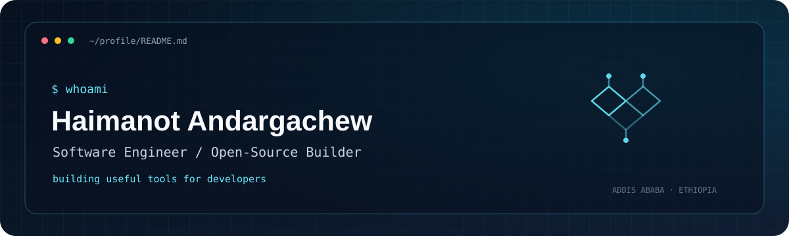

<div align="center">



<a href="https://github.com/Haimanot25"></a>
<a href="https://github.com/Haimanot25/dboard"></a>


<br>

<a href="https://git.io/typing-svg"></a>

</div>

---

## `whoami`

I’m **Haimanot Andargachew** — a software engineer who enjoys solving difficult engineering problems and building practical tools for developers.

- 🛠️ Building software with a focus on usefulness, reliability, and developer experience.
- 🧰 Exploring developer tooling, backend systems, automation, and open source.
- 🚀 Interested in turning rough ideas into tools people can actually use.
- 🌍 Based in Addis Ababa, Ethiopia.

## `featured_projects`

<table>
<tr>
<td width="50%" valign="top">

### [DBoard](https://github.com/Haimanot25/dboard)

**Turn databases into admin dashboards.**

A developer-focused project aimed at reducing the repetitive work involved in building database-backed admin interfaces.

`Next.js` · `React` · `TypeScript` · `Prisma` · `PostgreSQL`

<a href="https://github.com/Haimanot25/dboard"></a>

</td>
<td width="50%" valign="top">

### [dom2pdf](https://github.com/Haimanot25/dboard) HTML-to-PDF engine

**HTML in. Faithful, usable PDFs out.**

I developed an HTML-to-PDF rendering project with a focus on practical output quality and a developer-friendly workflow.

`Next.js` · `HTML` · `TypeScript` · `CLI` · 

<a href="https://github.com/Haimanot25/dom2pdf"></a>

</td>
</tr>
</table>

## `recent_projects`

<!-- RECENT_PROJECTS_START -->
| Repository | Description | Language | Stars |
| --- | --- | --- | ---: |
| [lograke](https://github.com/Haimanot25/lograke) | Universal adaptive production log intelligence platform to ingest, parse, search, and visualize logs | JavaScript | 1 |
| [dom2pdf](https://github.com/Haimanot25/dom2pdf) | HTML deserves better than screenshot-based PDFs. dom2pdf-js is an open-source JavaScript library foc | TypeScript | 1 |
| [dboard](https://github.com/Haimanot25/dboard) | Enterprise database admin panel with multi-DB support, AI-powered dashboard generation, real-time da | TypeScript | 2 |
| [utility-tools](https://github.com/Haimanot25/utility-tools) | utility tools for K8 | JavaScript | 0 |
| [sProject](https://github.com/Haimanot25/sProject) | No description yet | JavaScript | 0 |
| [ml-experiments](https://github.com/Haimanot25/ml-experiments) | big data ml analysis  | JavaScript | 0 |
<!-- RECENT_PROJECTS_END -->

## `toolbox`

<div align="center">

### Languages


### Frameworks & platforms


### Data & infrastructure


</div>

## `github_activity`

<div align="center">


</div>

<div align="center">


</div>

### Contribution garden

<!-- SNAKE_START -->
<div align="center">
  
</div>
<!-- SNAKE_END -->

## `connect`

<div align="center">

<a href="https://github.com/Haimanot25"></a>
<a href="https://www.linkedin.com/in/haimanot-andargachew-94a9aba4/"></a>

</div>

<div align="center">

```text
learn → build → test → ship → repeat
```

<sub>Designed with curiosity. Built with intention.</sub>

</div>
